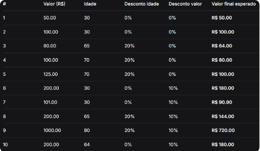

O que o codigo faz: Esse codigo foi criado com o proposito para contruir uma logica de PDV(Ponto de Venda), na qual, ele aplica descontos com base na idade( se for igual ou maior que 65 anos) e aplica desconto de valor de compra( e o valor do desconto de idade, mesmo sendo aplicado, for acima de 100).

Como ele faz:
1. Inicialização e Listas de Histórico

print("--- Sistema de..."): Exibe a mensagem de boas-vindas no terminal.

valores_brutos, valores_finais, descontos: Cria três listas vazias ([]) que atuarão como o banco de dados temporário do programa. Elas guardarão o histórico de cada transação para calcular o resumo no fim do dia.

2. O Laço Principal e Validação de Compra

while True: Inicia um loop contínuo para registrar múltiplas compras sem precisar reiniciar o programa.

Valor_de_Compra = float(input(...)): Captura o valor digitado e o converte para número decimal (float).

if Valor_de_Compra < 0: Bloqueia valores negativos. O comando continue força o laço a voltar para o início imediatamente, ignorando o resto do bloco.

if Valor_de_Compra == 0: Funciona como a válvula de escape do sistema. O comando break encerra o loop de repetição e o programa avança para o fechamento.

3. Entrada e Validação da Idade

Idade_do_Cliente = int(input(...)): Captura a idade e a converte para um número inteiro (int).

if Idade_do_Cliente < 0: Semelhante ao valor, impede o processamento de idades negativas utilizando o continue para reiniciar a rodada.

4. Lógica de Negócios e Descontos

Primeiro Filtro (Idade): Verifica se o cliente tem 65 anos ou mais para aplicar um desconto inicial de 20%. Se não tiver (else), o valor da rodada se mantém igual ao valor bruto original.

Segundo Filtro (Valor > 100): Verifica se o montante (já considerando o desconto anterior, se houver) ultrapassa R$ 100 para aplicar um desconto extra de 10%.

Condições Aninhadas (As Mensagens Exatas): Utiliza sub-condições (if dentro do if / else) para descobrir exatamente qual foi o trajeto matemático do usuário e exibir o texto correto na tela, garantindo que o sistema não avise sobre descontos inexistentes.

5. Processamento e Armazenamento (Append)

desconto_da_rodada: Calcula o dinheiro economizado subtraindo o valor pago do valor bruto da etiqueta.

.append(...): Pega os dados processados daquela compra e os insere como um novo item no final de suas respectivas listas, deixando-os salvos na memória.

6. Fechamento e Resumo do Dia

Esse bloco está fora da indentação do while, logo, só roda quando o usuário digita 0.

len(valores_brutos): Conta a quantidade exata de itens dentro da lista, revelando quantas compras foram feitas.

sum(...): Função nativa que soma automaticamente todos os números presentes nas listas, exibindo o total bruto, o total descontado e o caixa líquido final do sistema.

Como Rodar: o comando para executar o programa (python PDV.py).

Tabela de exemplos: